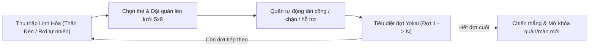

# Edo Garden Defense — Tài Liệu Thiết Kế Game (GDD)

> **Thể loại:** Lane-based Tower Defense (lấy cảm hứng từ *Plants vs. Zombies*)  
> **Phong cách:** Chibi Nhật Bản thời Edo  
> **Engine:** Godot 4.3+ (Compatibility Renderer / WebGL 2)  
> **Nền tảng:** Web (Desktop & Mobile Browser) và Mobile Native (Android / iOS)

---

## 1. Cốt Truyện & Thế Giới Quan (Storyline & Lore)

### 1.1. Bối cảnh
Vào cuối thời Edo, ngôi làng nhỏ **Hoa Anh Đào (Sakura-mura)** nằm yên bình dưới chân núi Linh Sơn. Trái tim của ngôi làng là **Khu Vườn Linh Thụ** nằm ngay trước ngôi nhà cổ của gia tộc Thủ Hộ — nơi lưu giữ **Linh Hỏa (Spirit Flame)**, ngọn lửa linh thiêng giúp mùa màng tươi tốt và xua đuổi tà khí suốt hàng trăm năm.

### 1.2. Biến cố mở đầu
Vào một đêm trăng tròn của mùa lễ hội **Bách Quỷ Dạ Hành (Hyakki Yagyō)**, phong ấn trên **Cổng Torii cổ** ở bìa rừng bất ngờ nứt vỡ. Bầy Yêu Quái (**Yokai**) từ rừng sâu, sông tối và núi tuyết bị thu hút bởi ánh sáng Linh Hỏa, kéo nhau tràn xuống làng hòng dập tắt ngọn lửa linh thiêng và chiếm lấy ngôi nhà cổ.

### 1.3. Vai trò của người chơi
Người chơi vào vai **Thủ Vườn Nhí (Khu Vườn Sư)** — người kế thừa cuối cùng có khả năng dùng **Linh Hỏa** để đánh thức các **Linh Thực & Bảo Vật Edo** (Đào tiên, Tre nỏ, Thần đèn, Bí ngô, Hồ lô băng...). Bạn phải sắp xếp đội hình phòng thủ hợp lý trên 5 lối vào khu vườn để đẩy lùi từng đợt Yokai trước khi chúng đặt chân vào nhà chính.

### 1.4. Hành trình 5 Chương (Campaign Arc)
Mỗi chương gắn liền với một bối cảnh, loại ô nền (Tile) và cơ chế đặc trưng khớp với bộ asset của dự án:

| Chương | Địa điểm | Thời điểm | Ô nền (Tiles) & Vật cản | Điểm nhấn Gameplay |
| :--- | :--- | :--- | :--- | :--- |
| **Chương 1** | **Sân Vườn Làng Hoa** *(MVP)* | Ban ngày | Cỏ xanh, Đất | Làm quen vòng lặp cốt lõi với 6 quân phòng thủ & 6 Yokai cơ bản. |
| **Chương 2** | **Rừng Tre Hoàng Hôn** | Chiều tà | Đá cuội, Đá rêu + Rào gỗ, Đá | Vật cản chặn ô đặt cây; Tengu bay qua hàng rào & Nekomata chạy nhanh. |
| **Chương 3** | **Hồ Cá Koi Đền Thần** | Ban đêm | Hồ cá Koi (làn giữa), Cánh hoa đào | Làn nước ở hàng giữa (cần cầu/lá sen hoặc cây tầm xa); Kappa kháng đòn & Miko ma triệu hồi. |
| **Chương 4** | **Thành Cổ Sương Mù** | Đêm sương | Sỏi xám + Rào gai, Thùng Sake | Thùng Sake phát nổ khi phá hủy; Samurai ma giáp dày & Rắn ống đánh đa mục tiêu. |
| **Chương 5** | **Đỉnh Núi Tuyết Trắng** | Bão tuyết | Tuyết trắng + Đống rơm | Gió tuyết & Yuki-onna đóng băng quân phòng thủ; Trận chiến với Trùm cuối Đại Oni. |

---

## 2. Thiết Kế Gameplay Cốt Lõi (Core Gameplay)

### 2.1. Sân đấu & Bố cục lưới (Grid System)
- **Kích thước lưới:** **5 hàng × 9 cột** (5 lanes × 9 columns).
  - Tỉ lệ này chuẩn xác cho màn hình ngang `16:9` trên cả Web lẫn Điện thoại, giúp mỗi ô có kích thước đủ lớn để người chơi chạm chính xác bằng ngón tay.
- **Cột 0 (Bên trái — Ngôi nhà cổ Edo):** Khu vực bảo vệ. Nếu bất kỳ Yokai nào vượt qua hàng phòng thủ cuối cùng và tiến vào nhà, màn chơi kết thúc (**Thua**).
- **Cột 1–9 (Sân vườn):** Khu vực trồng quân phòng thủ và chiến đấu.
- **Cột 10 (Ngoài rìa phải):** Điểm xuất hiện (Spawn zone) của các đợt Yokai.

### 2.2. Vòng lặp chiến đấu (Core Loop)


### 2.3. Hệ thống Tài nguyên — Linh Hỏa (Spirit Flame)
- **Nguồn tạo:**
  1. **Tự nhiên:** Rơi định kỳ từ trên màn hình (ở màn ban ngày, mỗi 8–10 giây rơi 1 Linh Hỏa trị giá `+25`).
  2. **Chủ động:** Do **Thần Đèn** tạo ra định kỳ (`+25` mỗi 12 giây).
  3. **Thưởng phụ:** Phá hủy Thùng Sake hoặc hạ gục Boss nhỏ.
- **Cơ chế thu thập tối ưu cho Web & Mobile:**
  - **Web:** Click chuột hoặc **di chuột qua (Hover)** để hút Linh Hỏa.
  - **Mobile:** Chạm vào hoặc **vuốt ngón tay qua nhiều ngọn Linh Hỏa cùng lúc (Swipe-to-Collect)**.
  - **Tùy chọn thân thiện:** Linh Hỏa tự động bay về kho sau 5 giây nếu không nhặt (hoặc bật/tắt chế độ Auto-Collect trong cài đặt) để giảm mỏi tay trên màn hình cảm ứng.

### 2.4. Phòng tuyến cuối cùng — Tượng Komainu (Last Line of Defense)
- Thay cho "Máy cắt cỏ" của PvZ, mỗi hàng ở rìa trái đặt một **Tượng Sư Tử Đá Komainu** (có sẵn trong bộ Props).
- Khi Yokai lần đầu vượt qua cột 1 của một hàng, tượng Komainu kích hoạt luồng linh lực lao thẳng về phía phải, **tiêu diệt toàn bộ Yokai trên hàng đó** (chỉ dùng 1 lần/hàng/màn).

### 2.5. Vật cản & Tương tác bản đồ (Obstacles)
Tận dụng 5 loại vật cản có sẵn trên assetsheet để tăng chiều sâu chiến thuật từ Chương 2 trở đi:
- **Tảng đá / Hàng rào gỗ / Thùng gỗ / Đống rơm:** Chiếm ô không thể đặt cây ngay; người chơi có thể phá vỡ bằng đạn hoặc dùng **Xẻng/Thu hồi** (tốn thời gian ngắn) để mở ô.
- **Rào gai:** Gây sát thương nhẹ theo thời gian cho Yokai đi ngang qua, nhưng bị phá hủy sau vài đòn đánh.
- **Thùng Sake:** Khi bị phá hủy sẽ nổ tung gây sát thương lan 3×3 lên Yokai xung quanh (rất thích hợp để tạo pha lật kèo).

---

## 3. Hệ Thống Quân Phòng Thủ (Defenders)

### 3.1. Nhóm Core MVP (6 quân — Giai đoạn P0)

| Quân phòng thủ | Vai trò | Linh Hỏa | Hồi chiêu | HP | Cơ chế chi tiết |
| :--- | :--- | :---: | :---: | :---: | :--- |
| **Đào tiên** | Bắn đơn cơ bản | 100 | 7s | 300 | Bắn cánh hoa anh đào thẳng 1 hàng (20 dmg / 1.4s). Rẻ, ổn định đầu trận. |
| **Tre nỏ** | Bắn nhanh / DPS | 200 | 7s | 300 | Bắn liên tiếp 2 mũi tên tre mỗi loạt (2×20 dmg / 1.4s). Chủ lực gây sát thương. |
| **Thần đèn** | Tạo tài nguyên | 50 | 7s | 250 | Phát sáng tạo `+25` Linh Hỏa mỗi 12s. Nền tảng kinh tế của mọi màn chơi. |
| **Bí ngô** | Chặn / Tank | 50 | 20s | 2400 | Tường chắn máu cực cao, giữ chân Yokai để tuyến sau xả sát thương. |
| **Nấm độc** | Sát thương lan | 150 | 10s | 300 | Phun làn khói độc tầm trung (3–4 ô), xuyên qua mọi kẻ địch trong phạm vi & **bỏ qua giáp Kappa/Samurai**. |
| **Hồ lô băng** | Làm chậm | 175 | 7s | 300 | Bắn cầu băng (20 dmg) và **làm chậm 45%** tốc độ di chuyển & đánh của Yokai trong 4s. |

### 3.2. Nhóm Mở rộng (4 quân — Giai đoạn P1)

| Quân phòng thủ | Vai trò | Linh Hỏa | Hồi chiêu | HP | Cơ chế chi tiết |
| :--- | :--- | :---: | :---: | :---: | :--- |
| **Pháo hoa** | Sát thương lớn (Instant) | 150 | 30s | — | Kích nổ ngay sau 0.8s khi đặt, gây **1200 dmg** vùng 3×3. Chuyên trị đợt lớn & Boss. |
| **Phù chú** | Gây choáng (CC) | 75 | 18s | — | Bùa kích hoạt khi Yokai giẫm phải, làm **choáng toàn bộ kẻ địch trong vùng 1×3** trong 4s. |
| **Gió lốc** | Đẩy lùi / Khắc chế bay | 125 | 15s | 300 | Thổi luồng gió mạnh đẩy lùi Yokai trên hàng 2 ô; **thổi bay Tengu** đang bay khỏi bản đồ. |
| **Chữa lành** | Hồi máu / Hỗ trợ | 100 | 15s | 350 | Ống nước tre Shishi-odoshi định kỳ **hồi 80 HP** cho các quân xung quanh (vùng 3×3) và **giải đóng băng** từ Yuki-onna. |

---

## 4. Hệ Thống Kẻ Địch (Yokai)

### 4.1. Nhóm Core MVP (6 Yokai — Giai đoạn P0)

| Kẻ địch | Phân loại | HP | Tốc độ | Kỹ năng & Cách khắc chế |
| :--- | :--- | :---: | :---: | :--- |
| **Tiểu yêu** | Cơ bản | 180 | Trung bình | Yokai tiêu chuẩn, đi bộ và gặm quân phòng thủ. |
| **Oni nhỏ** | Trâu, khỏe | 450 | Chậm–TB | Máu cao, đập chùy đau hơn Tiểu yêu. Dùng Hồ lô băng + Tre nỏ. |
| **Nekomata** | Nhanh | 150 | Rất nhanh | Lao cực nhanh vào tuyến trước. Khắc chế bằng Bí ngô chặn đầu hoặc Hồ lô băng. |
| **Kappa** | Kháng đòn | 380 | Trung bình | Mai rùa giảm 40% sát thương đạn thường; đi nhanh trên ô nước. **Khắc chế bằng Nấm độc** (bỏ qua giáp). |
| **Tengu** | Bay / Nhảy | 260 | Nhanh | **Bay/nhảy vượt qua Bí ngô** ở lần chạm đầu tiên. Khắc chế bằng Gió lốc hoặc đặt 2 lớp chặn. |
| **Oni lớn** | Trùm thường | 1800 | Rất chậm | Máu cực dày, đập 1 cú phá hủy hoặc gây sát thương cực lớn lên cây. Cần Pháo hoa + Làm chậm + Tập trung hỏa lực. |

### 4.2. Nhóm Mở rộng (4 Yokai — Giai đoạn P1)

| Kẻ địch | Phân loại | HP | Tốc độ | Kỹ năng & Cách khắc chế |
| :--- | :--- | :---: | :---: | :--- |
| **Miko ma** | Triệu hồi | 320 | Chậm | Dừng lại mỗi 10s để triệu hồi 2 Tiểu yêu ở làn trên và dưới. Cần tiêu diệt sớm bằng Pháo hoa / Nấm độc. |
| **Samurai ma** | Giáp dày | 850 | Chậm | Có lớp giáp trụ 500 HP trước khi trừ vào máu thật. Dùng Nấm độc (xuyên giáp) hoặc Tre nỏ + Làm chậm. |
| **Yuki-onna** | Đóng băng | 360 | Trung bình | Phun hơi lạnh đóng băng quân phòng thủ gần nhất trong 5s. **Khắc chế bằng Chữa lành** (giải băng) hoặc Pháo hoa. |
| **Rắn ống** | Đa mục tiêu | 420 | Nhanh | Có thể **trườn đổi làn (lane-switch)** khi gặp Bí ngô và tấn công đồng thời 2 ô trước mặt. Khắc chế bằng Phù chú gây choáng. |

---

## 5. Thiết Kế UX/UI Tối Ưu Cho Cả Web & Điện Thoại

### 5.1. Tỉ lệ màn hình & Responsive Viewport
- **Độ phân giải chuẩn (Base Resolution):** `1280 × 720` (tỉ lệ `16:9`).
- **Cài đặt Godot Stretch Mode:** `canvas_items` + Aspect `expand` (giữ nét chữ và UI sắc nét ở mọi độ phân giải, phần nền trang trí hai bên mở rộng tự nhiên cho màn hình điện thoại tràn viền `19.5:9` hoặc `20:9`).
- **Safe Area:** Toàn bộ HUD (thanh thẻ bài, nút tạm dừng, bộ đếm Linh Hỏa) đặt bên trong vùng an toàn để không bị che bởi tai thỏ / Dynamic Island / thanh điều hướng trên iOS & Android.
- **Xoay màn hình trên Mobile Web:** Khi người dùng mở game ở chế độ dọc (Portrait), hiển thị lớp phủ gọn nhẹ *"Vui lòng xoay ngang điện thoại để bảo vệ Khu Vườn Edo"* kèm biểu tượng xoay.

### 5.2. Hệ thống Điều khiển Kép (Dual Input)
| Thao tác | Trên Web (Chuột & Phím) | Trên Điện thoại (Cảm ứng) |
| :--- | :--- | :--- |
| **Trồng quân** | Click thẻ → Click ô (hoặc kéo thả). Phím `1–8` chọn nhanh thẻ. | **Chạm thẻ → Chạm ô** (mặc định, tránh ngón tay che ô). Hỗ trợ kéo thả kèm **bóng xem trước lệch lên trên `+60px`**. |
| **Hủy chọn / Hủy trồng** | Chuột phải hoặc phím `Esc`. | Chạm ra ngoài lưới hoặc chạm lại vào thẻ đang chọn. |
| **Thu thập Linh Hỏa** | Click hoặc di chuột qua (Hover). | Chạm hoặc **vuốt ngón tay qua nhiều ngọn lửa**. |
| **Xẻng (Thu hồi cây)** | Click nút Xẻng hoặc phím `X` → Click cây (hoàn 25% Linh Hỏa). | Chạm nút Xẻng → Chạm cây (có khung sáng đỏ xác nhận ô đang chọn). |
| **Tốc độ & Tạm dừng** | Phím `Tab` (1x / 2x), `Space` (Tạm dừng). | Nút bấm kích thước tối thiểu `56×56px` ở góc phải trên. |

### 5.3. Bố cục Giao diện (HUD Layout)
- **Thanh trên cùng (Top Bar — chiếm ~14% chiều cao):**
  - Trái: Bộ đếm **Linh Hỏa** (icon lửa xanh + số lớn dễ đọc).
  - Giữa: Hàng **Thẻ quân phòng thủ** (6 thẻ ở P0, mở rộng tối đa 8 thẻ ở P1) hiển thị giá Linh Hỏa và lớp phủ hồi chiêu (cooldown radial/vertical).
  - Phải: Nút **Xẻng**, Thanh tiến độ **Đợt quái (`Đợt X / 10`)**, Nút **Tăng tốc (`>>`)**, Nút **Tạm dừng (`||`)**.
- **Khu vực trung tâm (~86% chiều cao):** Toàn bộ không gian dành cho lưới **5×9**, nhà cổ Edo bên trái và đường Yokai tiến vào bên phải — không đặt nút bấm nào ở cạnh dưới để tránh chạm nhầm khi cầm điện thoại bằng hai tay.

---

## 6. Kiến Trúc Kỹ Thuật Godot 4 (Web & Mobile Ready)

### 6.1. Cấu hình Engine tối ưu đa nền tảng
- **Godot Version:** `4.3` hoặc mới hơn.
- **Renderer:** **Compatibility (OpenGL ES 3.0 / WebGL 2.0)** — bắt buộc để chạy mượt trên cả trình duyệt Desktop, Safari iOS và Chrome Android.
- **Web Export:** Sử dụng **Single-Threaded Web Export** (không cần `SharedArrayBuffer` / header COOP-COEP), giúp deploy cực dễ lên itch.io, GitHub Pages, Vercel hoặc Netlify.
- **Texture & Asset:**
  - Dùng `Sprite2D` + `AnimationPlayer` hoặc `AnimatedSprite2D` với SpriteSheet đóng gói gọn.
  - Bật `VRAM Compression` / định dạng nhẹ (PNG tối ưu hoặc WebP) để tổng dung lượng bản Web `< 15 MB` (tải xong trong vài giây trên 4G).

### 6.2. Cấu trúc Thư mục & Kiến trúc Data-Driven
Thiết kế tách biệt **Dữ liệu (`Resource`)** và **Logic (`Scene/Script`)** để dễ cân bằng chỉ số và thêm quân/quái mới mà không cần sửa code lõi:

```text
edo-garden-defense/
├── project.godot
├── docs/
│   └── GDD.md
├── assets/
│   ├── sprites/          # defenders/, enemies/, tiles/, props/, fx/, ui/
│   ├── audio/            # bgm/, sfx/
│   └── fonts/
├── data/                 # Các file .tres (Custom Resources)
│   ├── defenders/        # dao_tien.tres, tre_no.tres, ...
│   ├── enemies/          # tieu_yeu.tres, oni_nho.tres, ...
│   └── levels/           # level_01.tres, level_02.tres, ...
└── scenes/
    ├── main/             # MainMenu, LevelSelect, BattleScene
    ├── grid/             # BattleGrid, GridCell, KomainuDefender
    ├── entities/
    │   ├── defenders/    # BaseDefender.tscn + các script hành vi
    │   ├── enemies/      # BaseEnemy.tscn + các script hành vi
    │   └── projectiles/  # BaseProjectile.tscn, SpiritFlame.tscn
    └── ui/               # BattleHUD, SeedCard, PauseModal, ResultModal
```

### 6.3. Tối ưu hiệu năng cho Web & Mobile
1. **Object Pooling:** Tái sử dụng đạn (cánh hoa, tên tre, cầu băng), hiệu ứng trúng đòn và Linh Hỏa thay vì `instantiate()` / `queue_free()` liên tục gây giật khung hình (GC spike) trên WebAssembly.
2. **Collision Layers tối giản:** Phân tách rõ Layer/Mask (`Layer 1: Defender`, `Layer 2: Enemy`, `Layer 3: Projectile`, `Layer 4: Collectible`), sử dụng `Area2D` nhẹ thay vì `CharacterBody2D` cho toàn bộ đơn vị di chuyển thẳng theo làn.
3. **Save System đa nền tảng:** Lưu tiến trình qua `user://save.json` (tự động ánh xạ vào `IndexedDB` trên Web và bộ nhớ trong trên Mobile).

---

## 7. Lộ Trình Phát Triển (Roadmap)

Bám sát Checklist ưu tiên từ assetsheet của dự án:

- **Giai đoạn P0 (Core MVP — Chơi được ngay trên Web & Mobile):**
  - Khởi tạo project Godot 4 (Compatibility, Responsive 16:9, Dual Input).
  - Xây dựng lưới `5×9`, hệ thống Linh Hỏa, Thanh thẻ bài, Xẻng, Tốc độ `1x/2x`, Tượng Komainu.
  - Hoàn thiện **6 quân cơ bản** + **6 Yokai cơ bản** + **3 màn chơi Chương 1** (cỏ xanh/đất).
  - Test xuất bản **HTML5 Web** và kiểm thử cảm ứng trên điện thoại.
- **Giai đoạn P1 (Mở rộng chiến thuật):**
  - Bổ sung **4 quân mở rộng** (Pháo hoa, Phù chú, Gió lốc, Chữa lành) & **4+ Yokai mở rộng** (Miko ma, Samurai ma, Yuki-onna, Rắn ống).
  - Thêm hiệu ứng trạng thái (cháy, choáng, đóng băng, hồi máu, đẩy lùi) và hệ thống vật cản (Đá, Rào gai, Thùng Sake).
- **Giai đoạn P2 (Hoàn thiện sản phẩm):**
  - Hoàn thiện đủ 5 Chương bối cảnh (Làng hoa → Rừng tre → Hồ cá Koi → Thành cổ → Núi tuyết).
  - Animation đầy đủ 4+ frame (idle, attack, hit, die), âm thanh SFX/nhạc nền phong cách Nhật Bản (nhạc cụ Shamisen, sáo Shakuhachi, trống Taiko).
  - Hệ thống nâng cấp/ngọc bội giữa các màn và tối ưu UX hoàn chỉnh.
